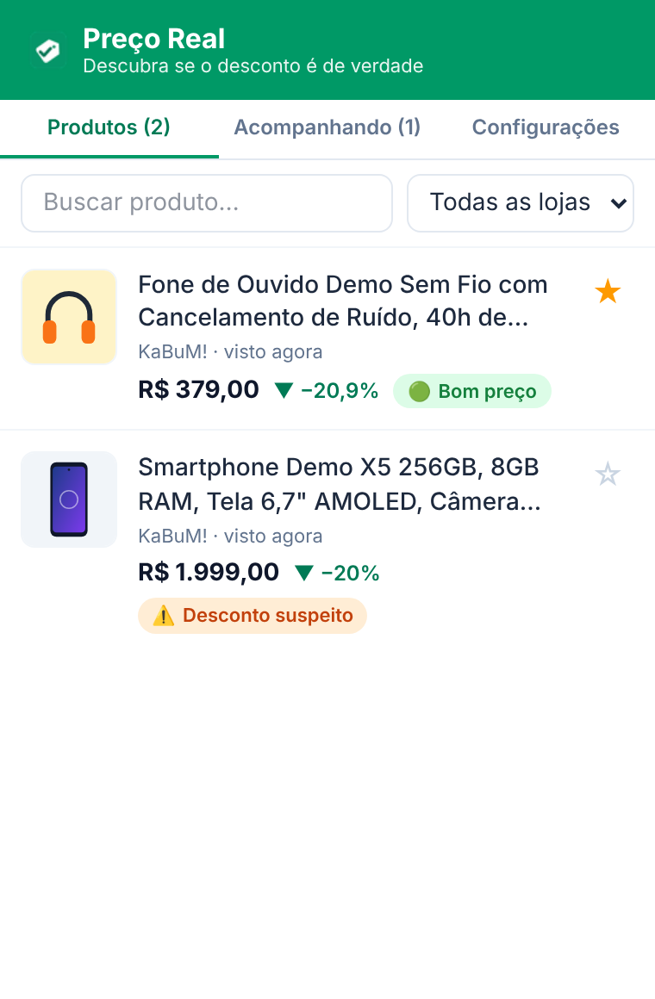
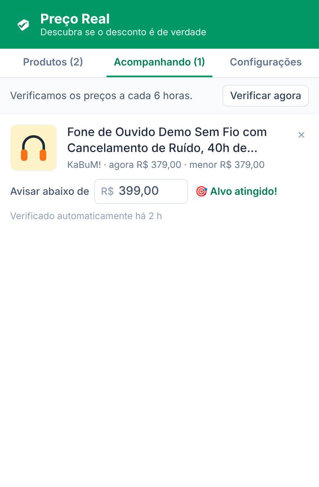
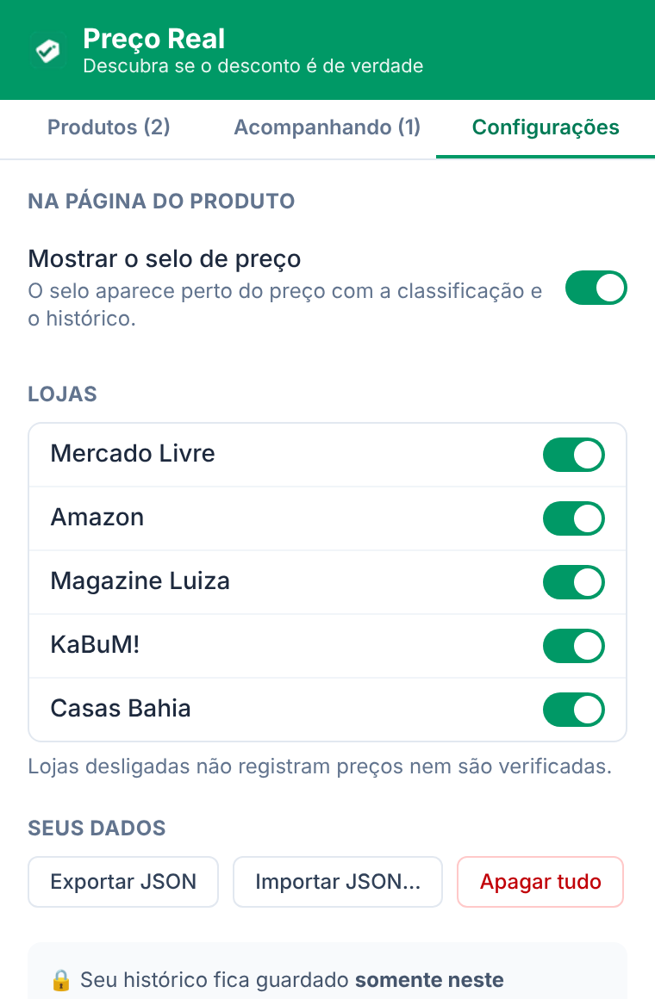
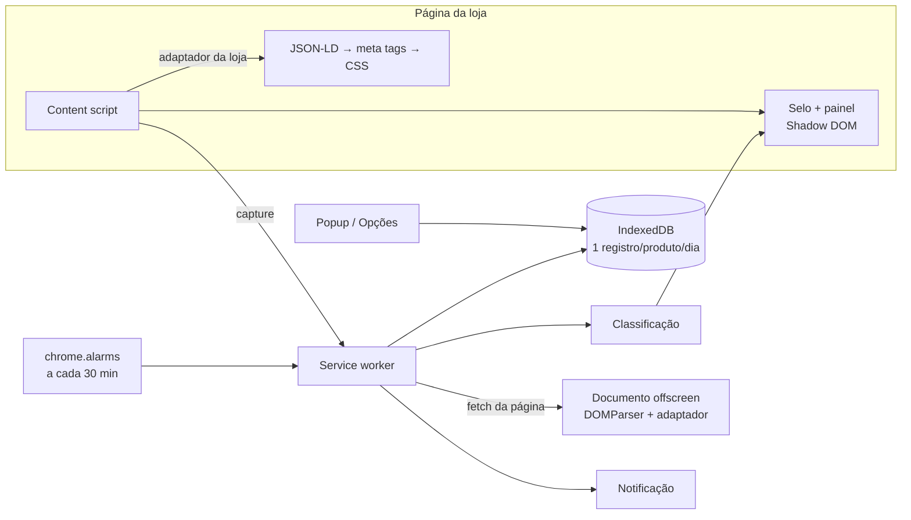

<div align="center">


# Preço Real

**Extensão para Chrome que mostra o histórico de preços nas lojas online brasileiras e diz se o desconto é de verdade.**

Mercado Livre · Amazon Brasil · Magazine Luiza · KaBuM! · Casas Bahia


</div>

## O problema

Em datas como Black Friday é comum ver o "**de R$ 2.499 por R$ 1.999**" em produtos que custavam R$ 1.899 uma semana antes. O preço sobe, a "promoção" traz ele de volta, e o consumidor não tem como saber, porque a loja só mostra o preço de hoje.

O **Preço Real** guarda o preço de cada produto que você visita, um registro por dia, e usa esse histórico para dizer na própria página da loja se aquele preço é bom, normal, alto ou se o desconto é maquiagem.

## Funcionalidades

- **Selo na página do produto**, ao lado do preço, com uma de cinco classificações:

  | | Classificação | Regra |
  |---|---|---|
  | 🟢 | Bom preço | Mais de 5% abaixo da média dos últimos 30 dias |
  | 🟡 | Preço normal | Até 5% da média, para cima ou para baixo |
  | 🔴 | Preço alto | Mais de 5% acima da média |
  | ⚠️ | Desconto suspeito | O preço "de" riscado é maior que qualquer preço já registrado, **ou** o preço subiu 10% ou mais nos 7 dias anteriores e a "promoção" só o trouxe de volta |
  | ⚪ | Sem histórico ainda | Menos de 3 dias de registros |

- **Painel com gráfico** (Chart.js): histórico de preço e de preço no Pix, linha da média de 30 dias, menor e maior preço com as datas e quantidade de dias registrados.
- **Popup** com todos os produtos vistos: foto, preço, variação, classificação, busca e filtro por loja.
- **Acompanhando**: marque um produto, defina o preço-alvo e receba uma **notificação do Chrome** quando o preço cair abaixo dele.
- **Verificação automática** com `chrome.alarms`: no máximo 1 vez a cada 6 horas por produto, um de cada vez e com pausa entre as consultas. Se uma verificação falha, ela é registrada e tentada de novo na próxima janela, sem travar o resto.
- **Configurações**: ligar e desligar o selo e cada loja, exportar e importar em JSON, apagar tudo.
- **Privacidade**: nada sai do navegador. Não há servidor, cadastro ou analytics, e as permissões se limitam aos 5 domínios das lojas.

<table>
  <tr>
    <td></td>
    <td></td>
    <td></td>
  </tr>
  <tr align="center"><td>Produtos vistos</td><td>Preço-alvo e alertas</td><td>Configurações</td></tr>
</table>


## Como funciona



### Decisões técnicas

- **Um adaptador por loja, com a mesma interface** (`src/adapters/types.ts`). A função `createAdapter` segue a ordem **JSON-LD (schema.org Product/Offer) → meta tags → seletores CSS da loja**. Adicionar uma loja é um arquivo de cerca de 30 linhas.
- **Preços que carregam depois**: um `MutationObserver` com *debounce* espera o preço aparecer, percebe troca de variação e navegação sem recarregar a página (SPA).
- **Um registro por dia**: a chave `[produto, AAAA-MM-DD]` guarda o **menor** preço do dia, por mais vezes que a página seja aberta.
- **O selo não quebra o layout**: fica num Shadow DOM fechado, posicionado sobre a página. O conteúdo da linha do preço é medido com `Range` para o selo ficar logo depois do texto, sem cobrir nada.
- **Verificação em segundo plano sem DOM**: o service worker do MV3 não tem `DOMParser`. O HTML baixado vai para um documento *offscreen*, que roda **os mesmos adaptadores** usados na página.
- **Regras de classificação puras e testadas** (`src/core/classify.ts`), com os limites em constantes fáceis de ajustar.
- **Formatação brasileira em todo lugar**: `R$ 1.234,56`, datas `dd/mm/aaaa` e interpretação de preços como "1.299", "R$ 1.299,90" ou "1299.90" (JSON-LD).

### Testes

- **77 testes unitários** (Vitest + jsdom + fake-indexeddb): leitura de preços, classificação, armazenamento, exportação e importação, verificador de alertas, posicionamento do selo, painel e um teste por loja.
- **Fixtures de páginas** em `tests/fixtures/<loja>/`, cada uma com um `.json` do resultado esperado. Quando uma loja muda o layout, o teste da fixture falha. Para adicionar uma página real, salve-a com Ctrl+S e veja `tests/fixtures/README.md`.
- **Ponta a ponta** (`pnpm e2e`, Playwright): carrega a extensão compilada no Chromium, abre as fixtures nos domínios reais (com as requisições interceptadas), confere o IndexedDB, clica no selo, executa a verificação automática e confere a notificação.

## Tecnologias

[WXT](https://wxt.dev) · Manifest V3 · TypeScript (strict) · React 19 · Tailwind CSS 4 · Chart.js · idb (IndexedDB) · chrome.storage · Vitest · Playwright

## Instalação

### Pelo código-fonte

Requisitos: Node 20+ e pnpm.

```bash
git clone https://github.com/Augustodevv/pre-o-real.git
cd pre-o-real
pnpm install
pnpm build          # gera .output/chrome-mv3
```

1. Abra `chrome://extensions` e ative o **Modo do desenvolvedor**.
2. Clique em **Carregar sem compactação** e selecione a pasta `.output/chrome-mv3`.
3. Abra um produto em uma das lojas suportadas.

### Comandos

| Comando | O que faz |
|---|---|
| `pnpm dev` | Abre o Chrome com a extensão e recarga automática |
| `pnpm build` | Compila para `.output/chrome-mv3` |
| `pnpm zip` | Gera o `.zip` para a Chrome Web Store |
| `pnpm test` | Testes unitários |
| `pnpm e2e` | Compila e roda o teste de ponta a ponta |
| `pnpm compile` | Checagem de tipos |
| `pnpm assets` | Gera as imagens da Chrome Web Store em `store-assets/` |

## Estrutura

```
src/
├── adapters/        # um arquivo por loja + extração genérica (base.ts)
├── core/            # preço, datas, classificação, IndexedDB, verificador de alertas
├── content/         # observador de mudanças na página
├── background/      # fetch + offscreen, notificações
├── ui/              # selo, painel e gráfico
├── popup/           # abas do popup e configurações
└── entrypoints/     # background, content, popup, options, offscreen
tests/               # unitários e fixtures por loja
scripts/             # e2e, imagens da loja, ícones
store-assets/        # capturas e textos da Chrome Web Store
```

## Privacidade

O histórico fica apenas no IndexedDB do navegador. A única comunicação de rede é a consulta à página pública dos produtos que você marcou como "Acompanhando". [Política de privacidade completa](docs/privacidade.html).

## Próximos passos

- [ ] **Histórico compartilhado (opcional, desligado por padrão)** com Supabase. A extensão enviaria só loja, ID do produto, preço e data, sem dados pessoais nem histórico de navegação. Haveria validação de preços absurdos e limite de envios por instalação, para o gráfico já aparecer preenchido.
- [ ] Fixtures com HTML real de cada loja, renovadas periodicamente.
- [ ] Versão para Firefox (o WXT já suporta).

## Licença

[MIT](LICENSE)
